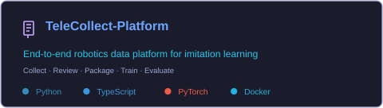
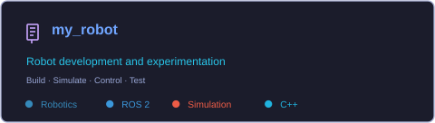
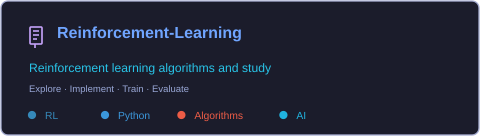
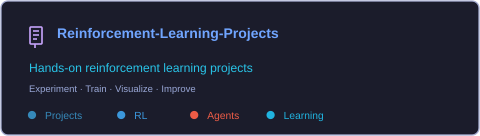

# 👋 Hi, I'm Dang Minh Quang

### 🤖 AI • Robotics • Reinforcement Learning • LLMs

---

# 🚀 About Me

- 🎓 Student at **HUS - VNU**
- 🤖 Passionate about **Robotics*
- 🧠 Interested in **Reinforcement Learning**
- 💬 Exploring **Large Language Models**

---

# 🚀 Featured Projects

  
  

  
  

---

---

# 📊 GitHub Analytics

  
  

  

---

# 🛠️ Tech Stack

## 🤖 Robotics

<!--  -->

---

## 🧠 AI & Machine Learning

---

## 💻 Programming Languages

---

## ⚙️ Tools

---

# 🎯 Current Focus

- 🤖 ROS2 Robot
- 🧠 Reinforcement Learning
- 💬 Large Language Models

---

# 📚 Currently Learning

- ✅ Python
- ✅ C++
- ✅ PyTorch
- ✅ Reinforcement Learning
- 🔄 ROS2

---

# 👀 Profile Views

  

---

### 💡 Quote

> *"Learning by building. Building by experimenting."*

